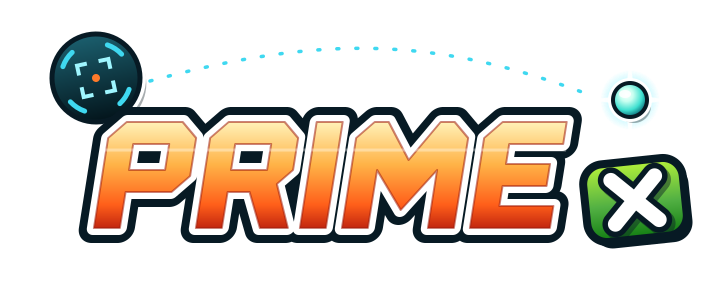

  

  
  
  
  
  

Metroid Prime, running natively on an original Xbox. No emulator. The game's own decompiled code, rebuilt for the Xbox's Pentium III and drawn by its NV2A GPU.

> **v1.0 beta.** This is the first public release, and it's a beta. The whole game should be playable from the Frigate to the credits, but it hasn't had wide testing yet, so you will run into bugs. If you do, turn on Port Options > System > Log File, play until it happens again, and send the `boot.log` with your report. Known problems are listed below.

This is the third port in the family, after [OpenCrossing-Xbox](https://github.com/TechProGabe/OpenCrossing-Xbox) (Animal Crossing) and [Melee-X](https://github.com/TechProGabe/Melee-X) (Super Smash Bros. Melee). Melee-X proved the Xbox can run a decompiled GameCube game at full speed; Prime-X takes the same GameCube-on-Xbox layer and puts Metroid Prime on it.

## What it is

The [PrimeDecomp](https://github.com/PrimeDecomp/prime) project turned Metroid Prime back into C++ source, and [MetroidPrimePort](https://github.com/Odrannnn/MetroidPrimePort) got that code running natively on little-endian PCs. Prime-X compiles that code for the Xbox's 733 MHz CPU, and Melee-X's GameCube graphics layer draws every frame on the Xbox's own GPU. The game data streams from your disc image the same way it would from a GameCube disc.

What you get:

- The whole game, Frigate Orpheon to the credits
- 480i, 480p or 720p, with **16:9 widescreen at both 480 and 720**, up to whatever your dashboard allows
- The game always runs at its proper speed. When a room is too heavy, the frame rate drops but the game doesn't slow down
- Settings right in the game's own screens, drawn in Prime's own visor style: **Port Options** on the main menu (no save file needed) and in the pause menu's Options
- A few extras on top of the GameCube game, all off or retail by default: skippable cutscenes, an edge-to-edge widescreen HUD, a field-of-view setting, an FPS counter, screenshots, button remapping, and the Fusion Suit (a GBA-link bonus on the GameCube)
- Rumble, and saves in the GameCube `.gci` format. Moving saves to and from Dolphin should work, but it hasn't been tested yet
- **L + R + Back + Black** on any controller quits to the dashboard

## How fast it runs

These numbers come from the release candidate on two retail consoles, both with the stock 733 MHz CPU and 64 MB of RAM. Each one is the median frame rate over a few minutes in that area.

| area | 480i | 720p |
|---|---|---|
| Frigate Crash Site, Space Pirate fight | 39 | 30 |
| Chozo Ruins, Main Plaza | 49 | 37 |
| Magmoor Caverns, Lava Lake | 43 | 34 |
| Tallon Overworld, Landing Site in the rain | 50 | 28 |
| Phendrana Drifts, switching visors | 51 | 32 |

Main Plaza at 480p ran at 46. The pause screen and menus run at 58 to 60.

In plain terms: at 480 expect 40 to 50 fps in most places, and the low 30s in big fights. At 720p expect around 30, a bit under in the heaviest rooms. To keep 720p even, the game updates its logic 30 times a second there. At 480 it updates 60 times a second and only drops to 30 on frames that can't keep up. A steady 60 at 480 is still the goal for later releases.

If you want the smoothest game, play at 480p. If you want the sharpest picture and are fine with about 30 fps, play at 720p.

The first time you go into a world there's a loading pause of about a second. On a nearly full stock hard drive it can be 4 or 5 seconds, and you may get short hitches now and then while the game swaps memory out to the drive.

## Known problems in this beta

- **Fog volumes aren't drawn.** Magmoor's lava haze and the fog over acid and water are missing, so those rooms look clearer than they should.
- **Sound can get stuck.** If the game comes up silent, switch the Xbox off at the power button and back on. A reset from the dashboard won't fix it. So far this has only happened when one app launches another directly; starting Prime-X from the dashboard has been fine.
- **Big fights are the slowest part of the game**, around 30 fps at 480.
- **The inside of your gunship** was slow in early testing and hasn't been measured since.
- **Slow or nearly full hard drives** make loads longer. Prime-X keeps an 8 MB swap file in `E:\UDATA\50580001\`, so leave some room free on E:.

## What you'll need

- A modded original Xbox (softmod or modchip) that runs homebrew. A stock 64 MB console is what it's tuned for. A 128 MB console runs in its first 64 MB.
- A way to copy files to it. Most dashboards (UnleashX, XBMC4Gamers, EvolutionX) have an FTP server built in.
- Your own dump of **Metroid Prime, NTSC-U, version 1.00** (game ID `GM8E01`, revision 0). `.iso`, `.gcm` and `.ciso` all work, and the file name doesn't matter. Other revisions and regions won't boot in this release.
- A controller. The Duke and the Controller S both work.

Nothing from Nintendo ships with this. You need your own copy of the game.

## Install

The same as Melee-X: grab `Prime-X-v1.0-beta.zip` from Releases, put your disc image in the `Prime-X` folder next to `default.xbe`, and FTP the folder to wherever your dashboard looks for apps or games (`F:\Applications\`, `E:\Games\`). Or pack both into one Xbox image with `tools/make-xiso` and burn it to a DVD-R. Updating is copying the new `default.xbe` and `default.tbn` over the old ones; saves and settings stay put.

## Controls

| Xbox | GameCube | Metroid Prime |
|---|---|---|
| A | A | fire |
| X | B | jump |
| B | X | Morph Ball |
| Y | Y | missile |
| White or Black | Z | map |
| Left trigger | L (analog) | lock on, scan |
| Right trigger | R (analog) | free aim |
| Left stick | Control stick | move |
| Right stick | C-stick | switch beams |
| D-pad | D-pad | switch visors |
| Start | Start | pause |
| L + R + Back + Black | | quit to the dashboard |

The buttons sit where they do on a GameCube pad, as on Melee-X. They can be remapped per controller in Port Options. In menus, B goes back.

## Video

Your dashboard decides what your TV and cables can handle, and Prime-X never goes past it.

- **480i** works on everything, composite included.
- **480p** needs component cables (or a VGA or HDMI adapter) and 480p turned on in the dashboard. It's the smoothest mode.
- **720p** needs component cables (or an HDMI mod or adapter) and 720p turned on in the dashboard. It's the sharpest picture and always 16:9, at around 30 fps.
- **Widescreen** at 480 shows more of the world instead of stretching it. Set widescreen in the dashboard and leave it on in Prime-X.

**Black screen?** Hold **Back** on any controller while Prime-X starts (the boot screen tells you when). That boot comes up in 480i and turns 720p and 480p off in your settings.

## First start

The first start checks every file of your disc image against the known-good copy. It takes about a minute, with the intro music playing. Later starts only check that the image is the one that passed. A bad or different dump gets a screen saying what's wrong instead of a crash later. To run the full check again, hold **L + R + Y** while Prime-X starts.

## Saves and logs

Saves go to `E:\UDATA\50580001\card_a\` as normal GameCube `.gci` files, written to a new file first and only then swapped in. Settings live in `E:\UDATA\50580001\settings.ini`.

If the game crashes or freezes, it writes `crash.log` or `hang.log` to `E:\UDATA\50580001\`. The everyday log, `boot.log`, is off by default because writing it slows things down on stock drives. Turn it on in Port Options > System > Log File when you want to report a bug.

## Building it

nxdk and LLVM 21, natively on Windows with MSYS2 (`tools/xbox/msys/build.sh`) or in Docker (`tools/xbox/docker/build.sh`), the same toolchain as Melee-X. Release builds use ThinLTO and profile-guided optimization with the committed profile (`XBOX_LTO=1 XBOX_PGO=xbox/prime.profdata`, [docs/pgo.md](docs/pgo.md)). Setup is in [docs/toolchain.md](docs/toolchain.md), testing in xemu and on consoles in [docs/testing.md](docs/testing.md), and [docs/](docs/README.md) has the rest. Where development stands: [docs/roadmap.md](docs/roadmap.md) and [docs/handoff.md](docs/handoff.md).

## Thanks

This port stands on a lot of other people's work:

- **[PrimeDecomp/prime](https://github.com/PrimeDecomp/prime)**, the decompilation. The whole game, as C++. Without it there is no port.
- **[MetroidPrimePort](https://github.com/Odrannnn/MetroidPrimePort)**, the native port that got the decomp running on little-endian machines.
- **[encounter/aurora](https://github.com/encounter/aurora)** for the Dolphin SDK headers, and **MusyX** for the audio engine.
- **[nxdk](https://github.com/XboxDev/nxdk)**, the open Xbox dev kit everything runs on, **[xemu](https://xemu.app)**, which does a lot of the testing, and **[xdvdfs](https://github.com/antangelo/xdvdfs)**, which packs the discs.
- Everyone who tested Melee-X and OpenCrossing-Xbox on real consoles: the Xbox layer Prime-X runs on is what their reports made.

## Legal

This repo has no game assets, no disc data and no Nintendo binaries. You'll need your own legally dumped copy of Metroid Prime, so please don't ask for ISOs.

This is an unofficial fan project, not affiliated with or endorsed by Nintendo, Retro Studios or Microsoft. Metroid Prime belongs to Nintendo, and Xbox is Microsoft's. Licensing is in [LICENSE.md](LICENSE.md).

AI tools (Claude) are used in developing this port.
